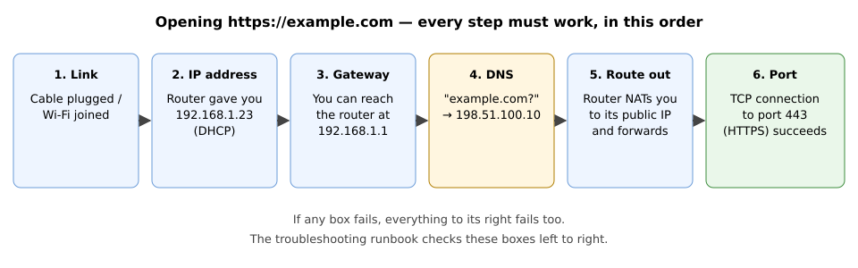
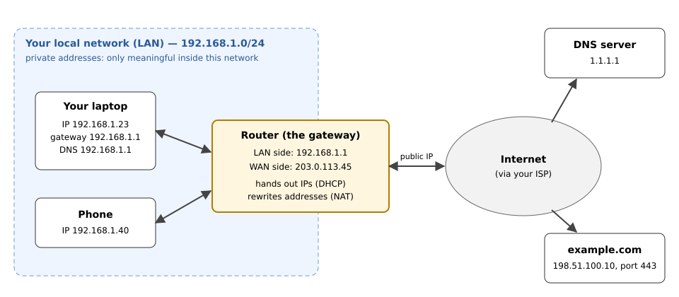

# Networking concepts, no commands

> [!NOTE]
> A concept page: no commands, just the mental model every other networking page
> assumes you have. Read it once, slowly.

## TL;DR

To open a website, six things must work **in order**: a link, an IP address, a reachable gateway, working DNS, a route out, and an open port. When "the internet is broken," exactly one of those six is broken, and the [runbook](internet-doesnt-work-runbook.md) finds which.

## When you need this

Before the [troubleshooting runbook](internet-doesnt-work-runbook.md), before [what's my IP](whats-my-ip-am-i-connected.md), and any time a networking page uses a word you don't know.

## The big picture

Hold onto this one analogy: **the network is a postal system.** Every concept below has a counterpart in it.

## The concepts

### IP address: your street address

An **IP address** is the number that identifies your machine on a network, like `192.168.1.23`. Every packet carries a sender address and a destination address, exactly like an envelope.

- **IPv4** looks like `192.168.1.23`: four numbers from 0 to 255.
- **IPv6** looks like `2001:db8::23`. It's newer and much longer, and it works on the same idea. You'll see both on Ubuntu; for now, focus on IPv4.

### Private vs public IP: house number vs city address

- **Private** addresses (`192.168.x.x`, `10.x.x.x`, `172.16–31.x.x`) only mean something *inside* your local network. Thousands of homes use `192.168.1.23` at the same time without clashing, the way every building has a "flat 1".
- **Public** addresses are unique on the whole internet. Your router has one (`203.0.113.45` in the diagram), and your laptop usually doesn't.

That's why "what's my IP?" has two correct answers: the private one your machine shows, and the public one websites see.

### Subnet: your street

A **subnet** is a group of addresses that can talk to each other directly, without going through a router. It's written as an address plus a number: `192.168.1.0/24`.

- `/24` means "the first three numbers are the street; the last number is the house." So `192.168.1.1` through `192.168.1.254` are all neighbours on one street.
- You'll also see the older form, a **netmask**: `255.255.255.0` means exactly the same as `/24`.

### Gateway: the post office at the end of your street

Anything addressed to *another* street goes to the **default gateway**, which is almost always your router (`192.168.1.1`). Your machine doesn't know how to reach the internet; it only knows "if it's not local, hand it to the gateway."

**No reachable gateway means no internet**, even if everything else is fine.

### Route: the rule that says where letters go

A **route** is a rule like "letters for `192.168.1.x` go directly; everything else goes to `192.168.1.1`." That *everything else* rule is the **default route**. A missing or wrong default route is a classic "Wi-Fi connected but no internet" cause.

### DHCP: the landlord who assigns your address

When you join a network, you don't pick an address yourself. A **DHCP** server (your router) assigns you one, together with your gateway and DNS server. That's why everything "just works" when you join Wi-Fi, and why nothing works if DHCP fails.

> [!TIP]
> An address starting with **`169.254.`** means *DHCP failed and your machine made one up*. It's a sure sign the problem is between you and the router.

### DNS: the phone book

Computers connect to IP addresses, while humans type names. **DNS** turns `example.com` into `198.51.100.10`.

If DNS breaks, the network still works, but names don't. The classic symptom: a site won't open by name, but things that use addresses directly still work. It's one of the most common "the internet is down" causes, and among the easiest to fix.

> [!NOTE]
> **On Ubuntu**, your DNS server will look like **`127.0.0.53`**. That's not a mistake: it's a local helper (`systemd-resolved`) that forwards your questions to the real DNS server. See [DNS on Ubuntu](dns-on-ubuntu.md).

### Port: the flat number inside the building

One machine runs many services at once. A **port** is a number (0–65535) that says *which service* a packet is for. The IP gets you to the building; the port gets you to the right door.

| Port | Service                 |
| ---- | ----------------------- |
| 22   | SSH (remote login)      |
| 53   | DNS                     |
| 80   | HTTP (web, unencrypted) |
| 443  | HTTPS (web, encrypted)  |

A service "**listening** on port 443" means it's waiting for visitors at door 443.

### TCP vs UDP: registered mail vs postcards

- **TCP** is registered mail. It sets up a connection first (the "handshake"), confirms every delivery, and resends anything lost. Web, SSH, and email use it.
- **UDP** is postcards. You send and hope; there's no setup and no confirmation. It's faster, which is why DNS queries, video calls, and games use it.

A firewall rule can allow TCP on a port and still block UDP on the same port. They're separate.

### NAT: the mailroom that rewrites the return address

Your private address (`192.168.1.23`) means nothing on the internet. So your router performs **NAT** (Network Address Translation): on the way out, it swaps your private address for its public one (`203.0.113.45`) and remembers who asked. When the reply comes back, it hands the reply to you.

Side effect: **nobody on the internet can start a connection *to* your laptop.** Outsiders only see the router. That's usually a good thing. It's also why "I started a server but my friend can't reach it" happens.

### MAC address: the name on the mailbox

A **MAC address** (`3c:22:fb:12:34:56`) is burned into your network card. It's used only within your local network, so routers never forward it to the internet. You'll rarely need it, except when a router whitelists devices by MAC.

## Check yourself

You understand this page if you can answer these without looking back:

1. Your laptop shows `192.168.1.23`, and a website says your IP is `203.0.113.45`. Which is wrong?
2. Wi-Fi shows connected, and your address is `169.254.12.7`. Where is the problem?
3. `ping 198.51.100.10` works, but the browser can't open `example.com`. Which of the six steps failed? 
4. Why can't your friend reach the web server running on your laptop at home? 

Answers

1. Neither. The first is your private address and the second is your router's public one (NAT).
2. Between you and the router: DHCP failed (step 2).
3. DNS (step 4). The network works, but name lookup doesn't.
4. NAT. Your laptop has no public address, so the router has no idea the incoming connection is for you.

## Related

- [The "internet doesn't work" runbook](internet-doesnt-work-runbook.md): these six steps, with commands
- [What's my IP / am I connected](whats-my-ip-am-i-connected.md)
- [Connections and ports](connections-and-ports.md)
- [Glossary](../appendix/glossary.md)
